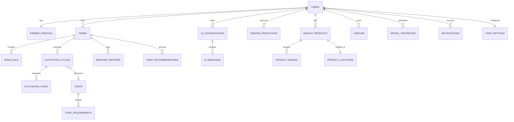
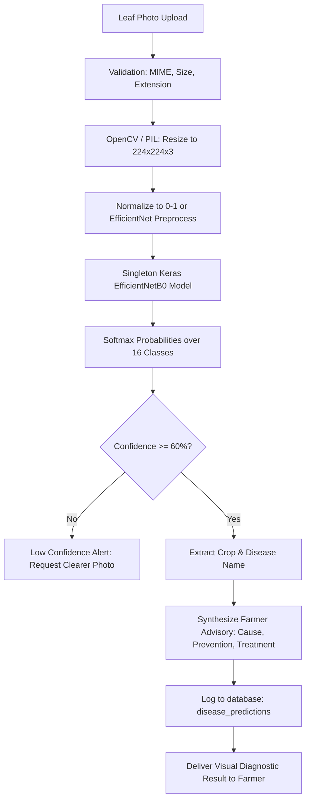
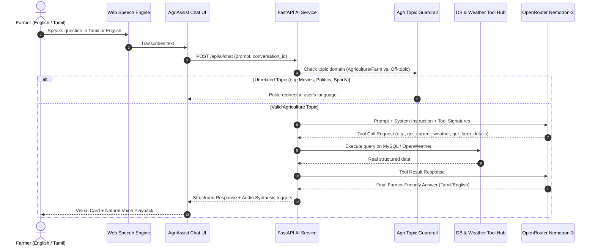

# AGRIASSIST — SYSTEM ARCHITECTURE DOCUMENTATION
**Tagline:** *"Your Farm. Your Data. Smarter Decisions."*

---

## 1. System Overview & Vision

AgriAssist is a mobile-first, enterprise-grade agricultural decision intelligence platform designed for smallholder and commercial farmers. Rather than isolating individual features (like a standalone chatbot or isolated weather forecast), AgriAssist unifies **Farmer Data**, **Farm Geospatial/Soil Attributes**, **Live Weather Intelligence**, **Crop Phenology**, **Deep Learning Leaf Disease Diagnostics**, and **Community Marketplaces (Produce, Labour, Equipment/Property Rentals)** into a central **Agricultural Decision Engine**.

```mermaid
graph TD
    subgraph Farmer Interaction
        Mobile[Mobile Web / PWA]
        Desktop[Desktop Browser]
        Voice[Voice Assistant - Tamil/English]
    end

    subgraph Frontend Layer - React + Vite + TS + Tailwind
        Router[React Router]
        I18n[Bilingual Engine - En/Ta]
        State[Contexts & Query Cache]
        UI[Design System - Deep Agri Green]
    end

    subgraph API Gateway - FastAPI
        AuthMW[JWT Auth & RBAC Middleware]
        CORS[CORS & Security Headers]
        RateLimiter[Rate Limiter]
        Routers[Domain Routers: Farm, Weather, AI, Disease, Market, Labour, Rental]
    end

    subgraph Core Decision Engine
        WeatherService[Weather Decision Intelligence]
        CropEngine[Rule & Data Crop Recommendation Engine]
        AgriAgent[OpenRouter Nemotron LLM + Function Calling]
        MLService[EfficientNetB0 PlantVillage Diagnostic Model]
    end

    subgraph Data & Storage
        MySQL[(MySQL 8.0 on Port 3307)]
        Alembic[Alembic Migrations]
        MediaStorage[Validated Media Storage / Uploads]
    end

    Farmer Interaction --> Frontend Layer
    Frontend Layer --> API Gateway
    API Gateway --> Core Decision Engine
    Core Decision Engine --> Data & Storage
```

---

## 2. Technology Stack

| Layer | Technologies Selected | Rationale |
|---|---|---|
| **Frontend Framework** | React 18/19, TypeScript, Vite | Ultra-fast HMR, strict type safety, responsive mobile-first performance. |
| **Styling & Design System** | Tailwind CSS, Lucide React, Custom CSS Tokens | Deep agricultural green palette (`#166534`, `#22C55E`, `#F7FAF7`), 48px touch targets, premium typography. |
| **Maps & Geospatial** | Leaflet + OpenStreetMap | 100% free, zero paid API keys required, pin dropping, polygon bounds, approximate location privacy. |
| **Charts & Visualizations** | Recharts | Light, responsive visualization for temperature trends, soil moisture, and crop progress. |
| **Form Management** | React Hook Form + Zod | Strict schema validation, progressive multi-step farm/crop registration, zero unnecessary re-renders. |
| **Voice Processing** | Web Speech API (SpeechRecognition + SpeechSynthesis) | Native browser-based STT & TTS with explicit Tamil (`ta-IN`) and English (`en-IN`/`en-US`) support. |
| **Backend Framework** | Python 3.10, FastAPI, Uvicorn | High-throughput asynchronous endpoints, automatic OpenAPI schema docs, native Pydantic v2 validation. |
| **Database & ORM** | MySQL 8.0 (Port 3307), SQLAlchemy 2.0, Alembic | Fully normalized relational schema, ACID compliance, foreign key integrity, migration version control. |
| **Authentication** | JWT (HS256) via `python-jose`, Passlib + `bcrypt` | Secure salted password hashing, stateless tokens, ownership verification middleware. |
| **Deep Learning Inference** | TensorFlow 2.16 / Keras 3.x, EfficientNetB0 | Pretrained PlantVillage leaf model (`best_leaf_disease_model.keras`), 16-class single-instance memory loading. |
| **AI LLM Agent** | OpenRouter (`nvidia/nemotron-3-ultra-550b-a55b:free`) | High-capacity reasoning LLM with strict agricultural system guardrails and multi-tool function execution. |
| **Weather Service** | OpenWeatherMap API (2.5 Metric) | Accurate real-time conditions + 5-day forecasts, in-memory caching to minimize external API roundtrips. |

---

## 3. Database Architecture & Schemas

The database `agriassist_db` runs on MySQL 8.0 on port 3307, managed via Alembic migrations.

### Entity-Relationship Diagram



### Table Specifications

1. **`users`**:
   - `id` (INT, PK, Auto-increment)
   - `name` (VARCHAR(120), NOT NULL)
   - `email` (VARCHAR(150), UNIQUE, NOT NULL, INDEX)
   - `phone` (VARCHAR(20), UNIQUE, NOT NULL, INDEX)
   - `password_hash` (VARCHAR(255), NOT NULL)
   - `is_active` (BOOLEAN, DEFAULT TRUE)
   - `created_at`, `updated_at` (DATETIME, TIMESTAMP)

2. **`farmer_profiles`**:
   - `id` (INT, PK)
   - `user_id` (INT, FK -> users.id, UNIQUE, CASCADE)
   - `preferred_language` (ENUM('en', 'ta'), DEFAULT 'en')
   - `location_name` (VARCHAR(255))
   - `latitude` (DECIMAL(10, 7), NULL)
   - `longitude` (DECIMAL(10, 7), NULL)
   - `experience_years` (INT, DEFAULT 0)
   - `primary_crop_type` (VARCHAR(100), NULL)
   - `created_at`, `updated_at`

3. **`farms`**:
   - `id` (INT, PK)
   - `user_id` (INT, FK -> users.id, CASCADE, INDEX)
   - `name` (VARCHAR(150), NOT NULL)
   - `land_area` (DECIMAL(8, 2), NOT NULL)
   - `area_unit` (ENUM('acres', 'hectares', 'cents', 'bigha'), DEFAULT 'acres')
   - `location_name` (VARCHAR(255), NOT NULL)
   - `latitude` (DECIMAL(10, 7), NOT NULL)
   - `longitude` (DECIMAL(10, 7), NOT NULL)
   - `water_source` (VARCHAR(100)) -- Borewell, Canal, Rainfed, Well, River
   - `irrigation_method` (VARCHAR(100)) -- Drip, Sprinkler, Flood, Furrow
   - `created_at`, `updated_at`

4. **`farm_soils`**:
   - `id` (INT, PK)
   - `farm_id` (INT, FK -> farms.id, CASCADE, INDEX)
   - `soil_type` (ENUM('clay', 'sandy', 'loamy', 'silty', 'red', 'black', 'laterite', 'unknown'), DEFAULT 'unknown')
   - `ph` (DECIMAL(4, 2), NULL)
   - `organic_matter_pct` (DECIMAL(4, 2), NULL)
   - `nitrogen_n` (DECIMAL(6, 2), NULL)
   - `phosphorus_p` (DECIMAL(6, 2), NULL)
   - `potassium_k` (DECIMAL(6, 2), NULL)
   - `ec` (DECIMAL(6, 2), NULL) -- Electrical Conductivity
   - `tested_at` (DATE, NULL)
   - `created_at`, `updated_at`

5. **`crops`**:
   - `id` (INT, PK)
   - `name` (VARCHAR(100), NOT NULL)
   - `tamil_name` (VARCHAR(100), NOT NULL)
   - `scientific_name` (VARCHAR(150), NULL)
   - `category` (ENUM('cereal', 'pulse', 'vegetable', 'fruit', 'oilseed', 'cash_crop', 'spice'))
   - `typical_duration_days` (INT, NOT NULL)
   - `water_requirement_level` (ENUM('low', 'moderate', 'high'))
   - `icon_url` (VARCHAR(255), NULL)
   - `created_at`, `updated_at`

6. **`crop_requirements`**:
   - `id` (INT, PK)
   - `crop_id` (INT, FK -> crops.id, CASCADE)
   - `suitable_soil_types` (JSON) -- array of soil strings
   - `min_ph` (DECIMAL(4, 2)), `max_ph` (DECIMAL(4, 2))
   - `min_temp_c` (DECIMAL(4, 1)), `max_temp_c` (DECIMAL(4, 1))
   - `ideal_season` (VARCHAR(100)) -- Kharif, Rabi, Zaid, Year-round
   - `estimated_input_cost_per_acre` (DECIMAL(10, 2))
   - `risk_level` (ENUM('low', 'medium', 'high'))
   - `yield_potential_per_acre` (VARCHAR(100))
   - `created_at`, `updated_at`

7. **`cultivation_cycles`**:
   - `id` (INT, PK)
   - `farm_id` (INT, FK -> farms.id, CASCADE, INDEX)
   - `crop_id` (INT, FK -> crops.id, RESTRICT)
   - `start_date` (DATE, NOT NULL)
   - `expected_harvest_date` (DATE, NOT NULL)
   - `actual_harvest_date` (DATE, NULL)
   - `status` (ENUM('PLANNED', 'IN_PROGRESS', 'HARVESTED', 'CANCELLED'), DEFAULT 'IN_PROGRESS')
   - `estimated_yield` (VARCHAR(100), NULL)
   - `notes` (TEXT, NULL)
   - `created_at`, `updated_at`

8. **`cultivation_tasks`**:
   - `id` (INT, PK)
   - `cycle_id` (INT, FK -> cultivation_cycles.id, CASCADE, INDEX)
   - `stage_name` (VARCHAR(100), NOT NULL) -- Land preparation, Sowing, Transplanting, Irrigation, Fertilization, Weeding, Pest monitoring, Flowering, Harvest
   - `title` (VARCHAR(200), NOT NULL)
   - `description` (TEXT, NULL)
   - `due_date` (DATE, NOT NULL, INDEX)
   - `status` (ENUM('PLANNED', 'IN_PROGRESS', 'COMPLETED', 'OVERDUE'), DEFAULT 'PLANNED')
   - `weather_note` (VARCHAR(255), NULL) -- Dynamic advisory
   - `completed_at` (DATETIME, NULL)
   - `created_at`, `updated_at`

9. **`weather_records`**:
   - `id` (INT, PK)
   - `farm_id` (INT, FK -> farms.id, CASCADE, INDEX)
   - `latitude` (DECIMAL(10, 7)), `longitude` (DECIMAL(10, 7))
   - `temperature_c` (DECIMAL(4, 1))
   - `feels_like_c` (DECIMAL(4, 1))
   - `humidity_pct` (INT)
   - `wind_speed_ms` (DECIMAL(4, 1))
   - `rain_probability_pct` (INT)
   - `condition_code` (VARCHAR(50))
   - `condition_text` (VARCHAR(100))
   - `fetched_at` (DATETIME, NOT NULL, INDEX)

10. **`crop_recommendations`**:
    - `id` (INT, PK)
    - `farm_id` (INT, FK -> farms.id, CASCADE, INDEX)
    - `crop_id` (INT, FK -> crops.id, CASCADE)
    - `suitability_score` (INT) -- 0 to 100
    - `soil_match_reason` (TEXT)
    - `weather_match_reason` (TEXT)
    - `water_match_reason` (TEXT)
    - `risk_assessment` (VARCHAR(100))
    - `input_cost_estimate` (VARCHAR(100))
    - `ai_summary` (TEXT)
    - `generated_at` (DATETIME, NOT NULL)

11. **`ai_conversations`** & **`ai_messages`**:
    - `ai_conversations`: `id`, `user_id` (FK), `title`, `created_at`, `updated_at`
    - `ai_messages`: `id`, `conversation_id` (FK, CASCADE), `sender` ('farmer' | 'ai'), `content` (TEXT), `tool_calls` (JSON, NULL), `tool_results` (JSON, NULL), `audio_url` (VARCHAR(255), NULL), `created_at`

12. **`disease_predictions`**:
    - `id` (INT, PK)
    - `user_id` (INT, FK -> users.id, CASCADE, INDEX)
    - `image_path` (VARCHAR(255), NOT NULL)
    - `model_name` (VARCHAR(100), DEFAULT 'EfficientNetB0')
    - `model_version` (VARCHAR(50), DEFAULT 'leaf-disease-v1')
    - `predicted_class` (VARCHAR(120), NOT NULL)
    - `crop_name` (VARCHAR(100), NOT NULL)
    - `disease_name` (VARCHAR(120), NOT NULL)
    - `confidence` (DECIMAL(5, 4), NOT NULL)
    - `ai_explanation` (TEXT, NULL)
    - `recommended_action` (TEXT, NULL)
    - `created_at`

13. **`market_products`**, **`product_images`**, **`product_locations`**:
    - Global marketplace shared across all users (no isolated DBs).
    - `market_products`: `id`, `seller_id` (FK -> users.id, CASCADE), `name`, `category` (Vegetables, Fruits, Grains, Seeds, Equipment, Organic, Other), `quantity`, `unit` (kg, quintal, bag, bunch, ton), `price_per_unit` (DECIMAL(10,2)), `description` (TEXT), `seller_phone`, `status` (ENUM('AVAILABLE', 'SOLD', 'DELISTED'), DEFAULT 'AVAILABLE'), `created_at`, `updated_at`
    - `product_images`: `id`, `product_id` (FK, CASCADE), `image_url`, `is_primary`
    - `product_locations`: `id`, `product_id` (FK, CASCADE), `location_name`, `latitude`, `longitude`

14. **`labours`**:
    - `id` (INT, PK)
    - `user_id` (INT, FK -> users.id, CASCADE)
    - `worker_name` (VARCHAR(150), NOT NULL)
    - `phone` (VARCHAR(20), NOT NULL)
    - `skills` (JSON) -- Planting, Harvesting, Weeding, Irrigation, Spraying, Ploughing, Machinery
    - `experience_years` (INT, NOT NULL)
    - `daily_wage` (DECIMAL(8, 2), NOT NULL)
    - `location_name` (VARCHAR(255), NOT NULL)
    - `latitude`, `longitude`
    - `availability_status` (ENUM('AVAILABLE', 'BUSY', 'INACTIVE'), DEFAULT 'AVAILABLE')
    - `description` (TEXT, NULL)
    - `created_at`, `updated_at`

15. **`rental_properties`**:
    - `id` (INT, PK)
    - `user_id` (INT, FK -> users.id, CASCADE)
    - `title` (VARCHAR(200), NOT NULL)
    - `owner_name` (VARCHAR(150), NOT NULL)
    - `phone` (VARCHAR(20), NOT NULL)
    - `land_area` (DECIMAL(8, 2), NOT NULL)
    - `area_unit` (VARCHAR(50), DEFAULT 'acres')
    - `monthly_rent` (DECIMAL(10, 2), NOT NULL)
    - `location_name` (VARCHAR(255), NOT NULL)
    - `latitude`, `longitude`
    - `available_from` (DATE, NOT NULL)
    - `available_until` (DATE, NULL)
    - `water_source` (VARCHAR(100))
    - `soil_type` (VARCHAR(100))
    - `description` (TEXT)
    - `images` (JSON)
    - `status` (ENUM('AVAILABLE', 'RENTED', 'INACTIVE'), DEFAULT 'AVAILABLE')
    - `created_at`, `updated_at`

16. **`notifications`**:
    - `id`, `user_id` (FK, CASCADE, INDEX), `type` ('weather', 'cultivation', 'harvest', 'marketplace', 'ai'), `title`, `message`, `is_read`, `action_url`, `created_at`

17. **`user_settings`**:
    - `id`, `user_id` (FK, UNIQUE), `language` ('en' | 'ta'), `weather_alerts_enabled`, `task_reminders_enabled`, `market_alerts_enabled`, `theme_mode` ('light'), `created_at`, `updated_at`

---

## 4. API Architecture & Endpoints

All endpoints return structured JSON. Standard error responses follow:
`{"error": {"code": "ERROR_CODE", "message": "User-friendly message"}}`

### 1. Auth & Users (`/api/auth`, `/api/users`)
- `POST /api/auth/signup`: Farmer name, email, phone, password, confirm_password, location, preferred_language. Returns JWT & profile.
- `POST /api/auth/login`: Email/Username + password. Returns JWT token & user object.
- `GET /api/users/me`: Current farmer profile, settings, and farm brief.
- `PUT /api/users/profile`: Update contact details, preferred language.
- `PUT /api/users/password`: Change password with old password verification.

### 2. Farms & Soil (`/api/farms`)
- `GET /api/farms`: List farmer's farms.
- `POST /api/farms`: Create new farm with map coordinates, soil attributes, irrigation, and water source.
- `GET /api/farms/{id}`: Detailed farm view with associated soil metrics and current active cultivation cycle.
- `PUT /api/farms/{id}`: Edit farm attributes.
- `DELETE /api/farms/{id}`: Soft delete or verify ownership before deletion.
- `PUT /api/farms/{id}/soil`: Update or log soil test analysis (pH, NPK, organic matter).

### 3. Weather Intelligence (`/api/weather`)
- `GET /api/weather/current?lat={lat}&lon={lon}`: Real-time temperature, condition, feels like, humidity, wind speed, rain probability, cached for 30 minutes.
- `GET /api/weather/forecast?lat={lat}&lon={lon}`: 5-day / 3-hour forecasts with rain windows and advisory flags.
- `GET /api/weather/advisory?farm_id={id}`: Actionable agricultural rules evaluated against upcoming weather (e.g., rain vs. scheduled irrigation or spray window).

### 4. Crops & Cultivation Calendar (`/api/crops`, `/api/cultivation`)
- `GET /api/crops`: Master crop directory with Tamil names, requirements, and growth durations.
- `GET /api/cultivation/cycles?farm_id={id}`: Active and historical cultivation cycles for a farm.
- `POST /api/cultivation/cycles`: Create new cultivation cycle (auto-generates standard agronomic task timeline from land prep to harvest).
- `GET /api/cultivation/tasks?cycle_id={id}&status={status}`: Filterable task list with due dates and statuses (`PLANNED`, `IN_PROGRESS`, `COMPLETED`, `OVERDUE`).
- `PUT /api/cultivation/tasks/{id}`: Update task status, mark completed, or adjust date.

### 5. Crop Recommendation Engine (`/api/recommendations`)
- `GET /api/recommendations/{farm_id}`: Rule-based suitability scoring combining soil type, pH, water supply, season, and current weather, with transparent reasoning (What, Why, When, Next Steps, Confidence).

### 6. AI Agriculture Agent (`/api/ai`)
- `POST /api/ai/chat`: Interactive chat endpoint. Integrates OpenRouter Nemotron-3 with function calling.
  - Guardrail: Refuses non-agricultural inquiries politely in the user's language.
  - Function Tools:
    1. `get_farmer_profile(user_id)`
    2. `get_farm_details(farm_id)`
    3. `get_current_weather(lat, lon)`
    4. `get_forecast(lat, lon)`
    5. `get_current_crop(farm_id)`
    6. `get_cultivation_calendar(cycle_id)`
    7. `get_crop_information(crop_name)`
    8. `get_market_products(category, location)`
    9. `get_disease_history(user_id)`
- `GET /api/ai/conversations`: List past conversation threads.
- `GET /api/ai/conversations/{id}`: Load thread history.

### 7. Plant Disease Diagnostics (`/api/disease`)
- `POST /api/disease/predict`: Accepts leaf image via `multipart/form-data`.
  - Image validation (JPEG, PNG, WebP, max 5MB).
  - Preprocessing: Resize to 224x224, normalize RGB.
  - EfficientNetB0 inference against 16 classes.
  - Confidence scoring. If confidence < 0.60: returns warning asking for a clearer photo.
  - Returns: `{prediction, crop, condition, confidence, model_version, status, ai_treatment_summary}`.
- `GET /api/disease/history`: Farmer's historical leaf diagnostics.

### 8. Local Marketplace (`/api/market`)
- `GET /api/market/products?category={cat}&search={q}&lat={lat}&lon={lon}`: Browse active listings (`status=AVAILABLE`) with public approximate locations.
- `POST /api/market/products`: Create new produce listing with photos, price, quantity, phone, and public location.
- `GET /api/market/products/{id}`: Detailed listing with seller contact modal and map marker.
- `PUT /api/market/products/{id}`: Seller-only update (e.g. mark SOLD).
- `DELETE /api/market/products/{id}`: Seller-only deletion.

### 9. Labour Marketplace (`/api/labours`)
- `GET /api/labours?skill={skill}&location={loc}`: Browse agricultural workers.
- `POST /api/labours`: Add labour listing (Name, skills, wage, contact, location).
- `PUT /api/labours/{id}`: Update availability or wage.

### 10. Rental Marketplace (`/api/rentals`)
- `GET /api/rentals`: Browse farm land and property rentals.
- `POST /api/rentals`: Post farm rental with land size, monthly rent, water availability, and photos.
- `GET /api/rentals/{id}`: Detailed property view with map.

### 11. Notifications & Settings (`/api/notifications`, `/api/settings`)
- `GET /api/notifications`: Recent farm notifications and alerts.
- `PUT /api/notifications/{id}/read`: Mark notification as read.
- `GET /api/settings`: User preferences (language, notifications, themes).
- `PUT /api/settings`: Save preferences.

---

## 5. Machine Learning Architecture



### Classes Handled:
1. `Pepper__bell___Bacterial_spot`
2. `Pepper__bell___healthy`
3. `Potato___Early_blight`
4. `Potato___Late_blight`
5. `Potato___healthy`
6. `Tomato_Bacterial_spot`
7. `Tomato_Early_blight`
8. `Tomato_Late_blight`
9. `Tomato_Leaf_Mold`
10. `Tomato_Septoria_leaf_spot`
11. `Tomato_Spider_mites_Two_spotted_spider_mite`
12. `Tomato__Target_Spot`
13. `Tomato__Tomato_YellowLeaf__Curl_Virus`
14. `Tomato__Tomato_mosaic_virus`
15. `Tomato_healthy`

*Note:* If an image is classified as outside these 3 crops (Pepper Bell, Potato, Tomato), the system transparently indicates supported plant categories instead of hallucinatory diagnoses.

---

## 6. AI Agent & Guardrail Architecture



---

## 7. UI/UX Design System & Layouts

### Visual Hierarchy & Palette
- **Primary:** Deep Agricultural Green `#166534` (Buttons, active states, key indicators)
- **Primary Light:** `#22C55E` (Growth accents, positive status)
- **Background:** `#F7FAF7` (Clean, soothing organic off-white)
- **Surface:** `#FFFFFF` (Elevated cards with subtle `#E2E8E2` borders)
- **Text Primary:** `#17251B` (Deep leafy slate, ultra readable)
- **Secondary Text:** `#64748B` (Clear informational subtitle contrast)
- **Accents:** Warning `#F59E0B`, Danger `#DC2626`, Info `#2563EB`

### Mobile & Desktop Responsive Layout
- **Mobile (< 768px):**
  - **Top Bar:** AgriAssist logo, language toggle (`EN` | `தமிழ்`), notification bell with unread badge, avatar.
  - **Hero Cards:** Distinct visual layouts (Weather hero, farm compact status, calendar progress bar, horizontal crop cards).
  - **Bottom Navigation Bar (48px+ touch targets):**
    `Home` | `AI Agent` | `Disease` | `Local Shop` | `More` (opens Farm, Calendar, Labours, Rentals, Settings)
- **Desktop (>= 1024px):**
  - **Left Sidebar:** Logo + Brand, navigation items with high-contrast active icons, bottom utility stack (Notifications, Settings, Profile).
  - **Top Header:** Search/Context bar, Farm switcher dropdown, weather ticker, language switcher, user profile.
  - **Split-Screen Layouts:** Multi-column view for farm dashboards, chat panel with side-by-side farm context, and marketplace grid with interactive Leaflet map.

---

## 8. Security & Production Quality
1. **Ownership Enforcement:** All private database mutations verify `resource.user_id == current_user.id`.
2. **Password Security:** Salted `bcrypt` password hashing (plaintext passwords never stored or logged).
3. **No Secret Leaks:** `OPENROUTER_API_KEY`, `OPENWEATHER_API_KEY`, and `DB_PASSWORD` are restricted to backend environment variables; never exposed to React clients.
4. **Structured Error Handling:** No internal stack traces or raw SQL queries leak to client responses.
5. **Alembic Versioning:** Database structure maintained purely via version-controlled migration scripts.
